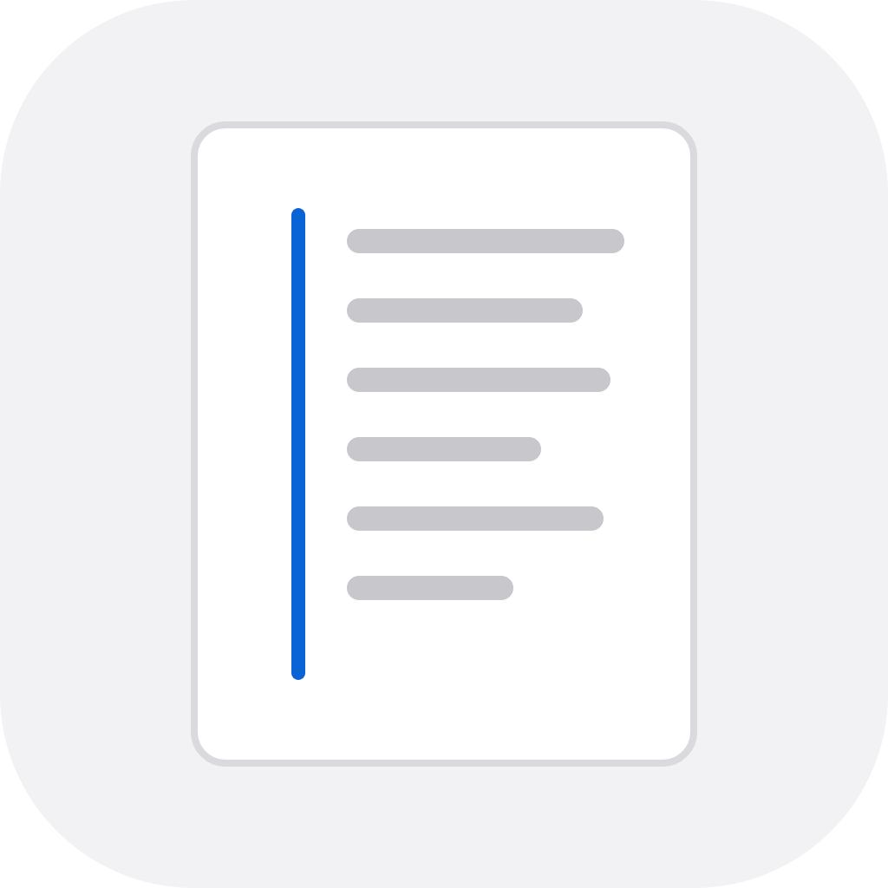
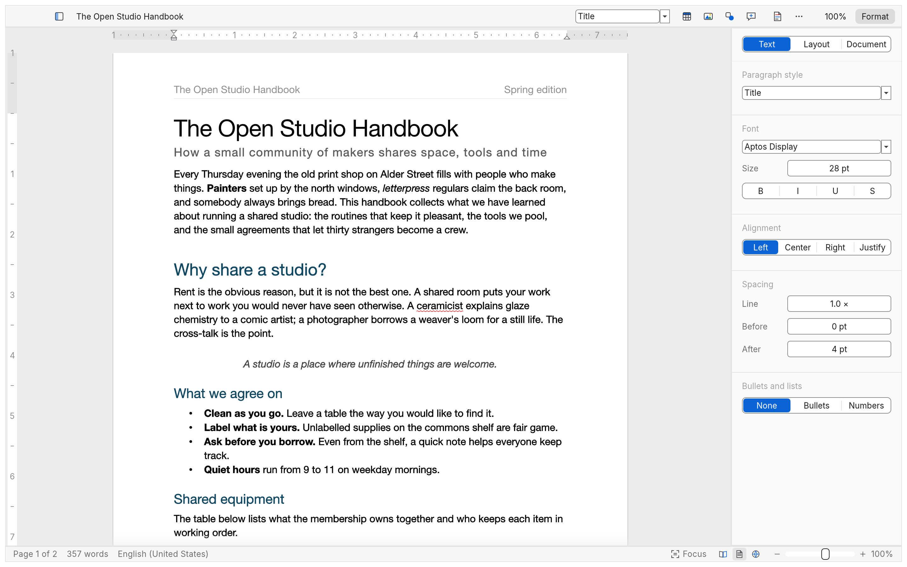

<p align="center"></p>

<h1 align="center">Margin</h1>

<p align="center"><b>A Mac-native interface for <a href="https://github.com/storytold/wordcraft">WordCraft</a>, the open-source word processor in pure Rust.</b></p>

<p align="center"></p>

Margin keeps WordCraft's document engine (.docx in and out, styles, tables, track changes,
references, PDF export) and replaces its Office-style ribbon with an interface that feels at home
on macOS:

- **One slim toolbar** instead of the ribbon: paragraph style, table, image, shape, comment, track changes, zoom.
- **A Format inspector** on the right, like Pages: Text, Layout and Document tabs.
- **The real macOS menu bar**, with the shortcuts you expect.
- **Pageless mode**, like Google Docs: one continuous sheet, Narrow / Medium / Full text width. Printing and PDF export still use pages.
- **Follows your Mac's light or dark appearance**, Apple's system blue, one calm type size throughout.
- **The classic ribbon is still there**: View › Classic Ribbon (⌃⌘R).

## Install

Download `margin-<version>-macos-universal.dmg` from [Releases](../../releases), open it and drag
Margin to Applications. macOS 11 or later, Apple silicon and Intel.

## Build from source

```bash
cargo run --release -p wordcraft -- --sample
```

Package a signed app: see [`docs/releasing.md`](docs/releasing.md). For Margin's branding, set
`APP_NAME=Margin BUNDLE_ID=ai.spert.margin APP_ICNS=assets/app-icon/margin.icns FILE_PREFIX=margin`
before `packaging/macos/package.sh`.

## How it relates to WordCraft

Margin is a fork that changes the interface only; the engine is WordCraft's. All Margin code lives
in a few files (`crates/ui-egui/src/skin.rs`, `mac_ui.rs`, `mac_menu.rs`,
`apps/wordcraft/src/mac_menu.rs`) with small hooks elsewhere, so upstream changes merge easily.
We offer the interface back to WordCraft as pull requests. Design decisions:
[`docs/decisions.md`](docs/decisions.md). WordCraft's own README: [`README-WordCraft.md`](README-WordCraft.md).

## License

MIT OR Apache-2.0, like WordCraft. Every bundled asset is listed in [`ATTRIBUTION.md`](ATTRIBUTION.md).
